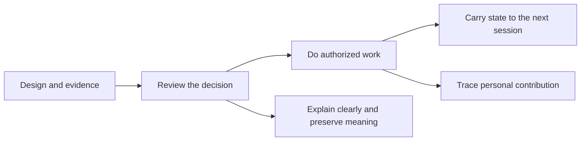

# Skills Workshop

**Small Agent skills for work that survives a closer look.**

[简体中文](README.zh-CN.md) · [日本語](README.ja.md)

An agent can produce a convincing answer while losing the current goal, treating a partial check as success, or taking credit for somebody else's work. This workshop turns those failure modes into explicit working rules.

I develop these workflows with AI assistance. The collection covers carrying work into the next session, reviewing designs, tracing personal contributions, and making technical writing clearer without changing its meaning. Each skill comes with fictional examples you can inspect, run through your own agent, and challenge.

## Start with a problem

| You have… | Try | What makes it useful |
|---|---|---|
| A long conversation and a fresh agent waiting | [handoff](skills/handoff/README.md) | Preserve the current goal, exact scope, evidence, and permission to continue. Historical commands stay historical. |
| A design that looks ready | [reviewing-design-documents](skills/reviewing-design-documents/README.md) | Eight questions before you build: what is missing, duplicated, conflicting, unsupported, ambiguous, infeasible, untestable, or unhandled when things fail? |
| A pile of work notes and a self-review deadline | [performance-self-review](skills/performance-self-review/README.md) | Build an evidence ledger before the narrative. Separate your actions, team outcomes, targets, and verified results. |
| A technical explanation that is hard to read | [simplify-tech-writing](skills/simplify-tech-writing/README.md) | Make the wording clearer while keeping conditions, numbers, identifiers and uncertainty. HTTP 200 must not turn into “recovered.” |

The [eight-question guide](skills/reviewing-design-documents/README.md#the-eight-questions) shows how the same questions apply to APIs, product launches and operating procedures. The questions travel; the evidence and acceptance criteria remain specific to the decision.

These are instruction-based skills. They guide an agent's reasoning and use of available tools. They do not train the underlying model, install a background service, or guarantee that an agent will follow every rule.

## Try one in five minutes

Clone the repository and inspect the examples. Python 3.10+ is needed only for the local checks.

```sh
git clone https://github.com/Henry2012/skills-workshop.git
cd skills-workshop
python3 tools/check.py
```

Then give your agent this prompt from the repository directory:

> Use the skill at `skills/reviewing-design-documents/SKILL.md`. Read its required rubric. Review `examples/design-review/design.md` for implementation readiness. Work read-only. Return the report in English.

Compare the result with [the reference review](examples/design-review/review.md). The useful test is whether your agent notices the contradictory definition of success, cites both statements, and keeps it as one root-cause finding.

The reference examples are authored walkthroughs using fictional inputs. The local checker verifies their contracts and repository integrity. It does **not** run an LLM or measure model accuracy. See [validation coverage](docs/VALIDATION.md).

## Use a skill in your own project

Read its `SKILL.md` and linked references first. Give an agent access to that directory and explicitly name the skill in your request. This works as a manual entry point without depending on a particular installation layout.

For native skill discovery, follow your agent's supported installation process and install only the selected directory under `skills/`. Keep its relative reference files together. Do not overwrite an existing skill with the same name without inspecting it.

The guides are available in English, Chinese, and Japanese. Runtime instructions retain their existing English/Chinese content and fixed output labels. You may request prose in your language. In particular, `handoff` retains its required Chinese section headings.

## How the pieces fit



This is a way to combine the skills, not an automatic pipeline. A review verdict is not permission to execute. A handoff is not a command replay. A self-review is not independent proof of business impact.

## What is mine

The four published workflows were developed by Henry2012 with AI assistance. My contribution is the choice of problems, operating constraints, acceptance rules, and iteration through use. AI-assisted drafting, packaging, and checks are part of the development process. The technical-writing skill acknowledges ASD-STE100 as an inspiration without redistributing the standard.

This repository publishes those workflows, portable demonstrations, and maintenance records. It does not present unmodified third-party skills as original work. See [provenance and license scope](docs/PROVENANCE.md) and [selection decisions](docs/SELECTION.md).

## Explore, change, report back

Run a fictional case. Change one fact. Check whether the conclusion changes for the right reason.

Good contributions include a reproducible failure, the smallest rule change that addresses it, and an example showing what should remain unchanged. Read [CONTRIBUTING.md](CONTRIBUTING.md) before submitting material. Never include work chats, private performance records, credentials, or internal URLs.

[MIT license](LICENSE) · [Maintenance](docs/MAINTENANCE.md) · [Changelog](CHANGELOG.md)
